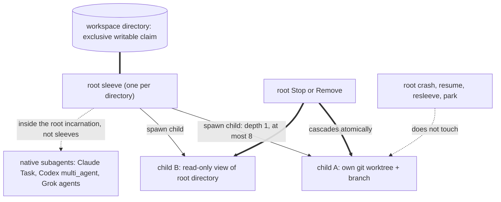
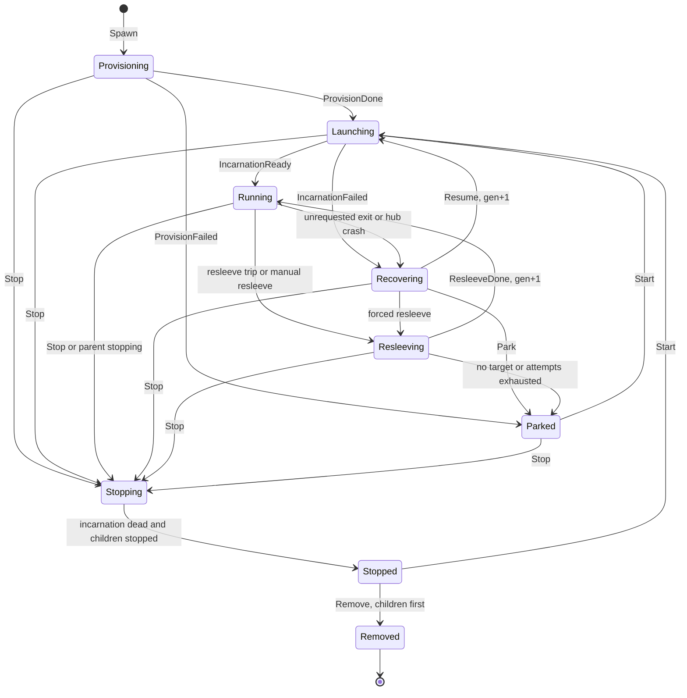
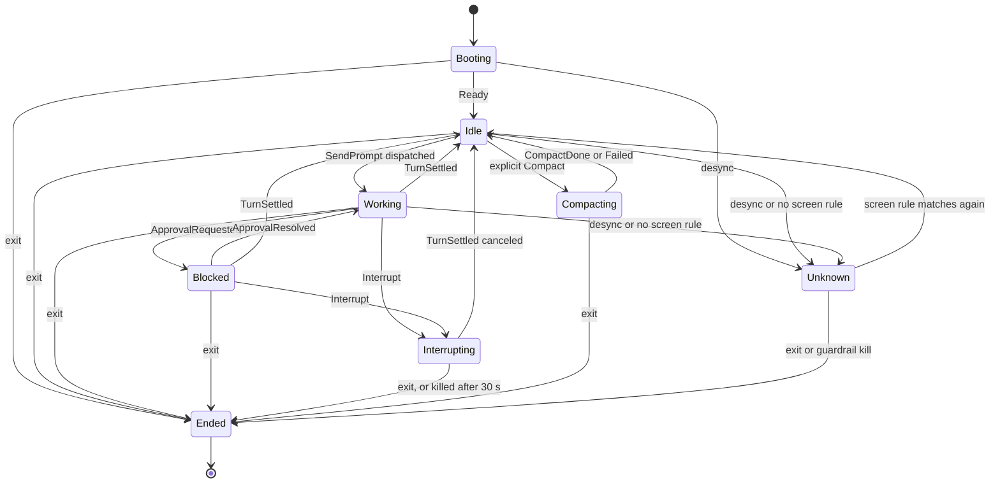
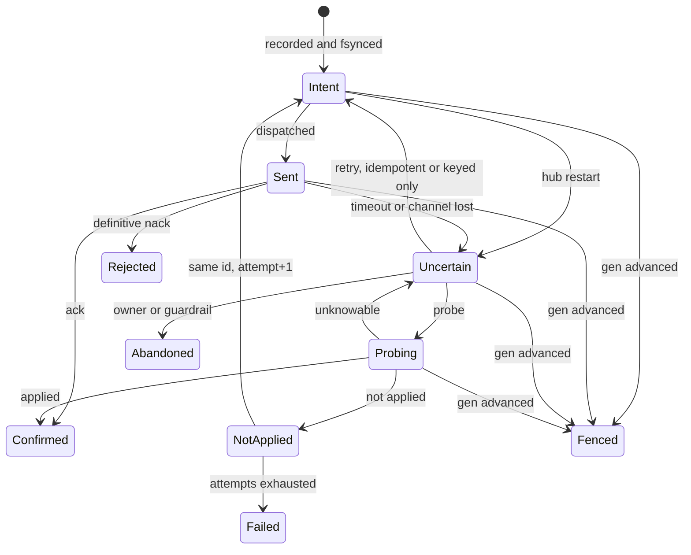
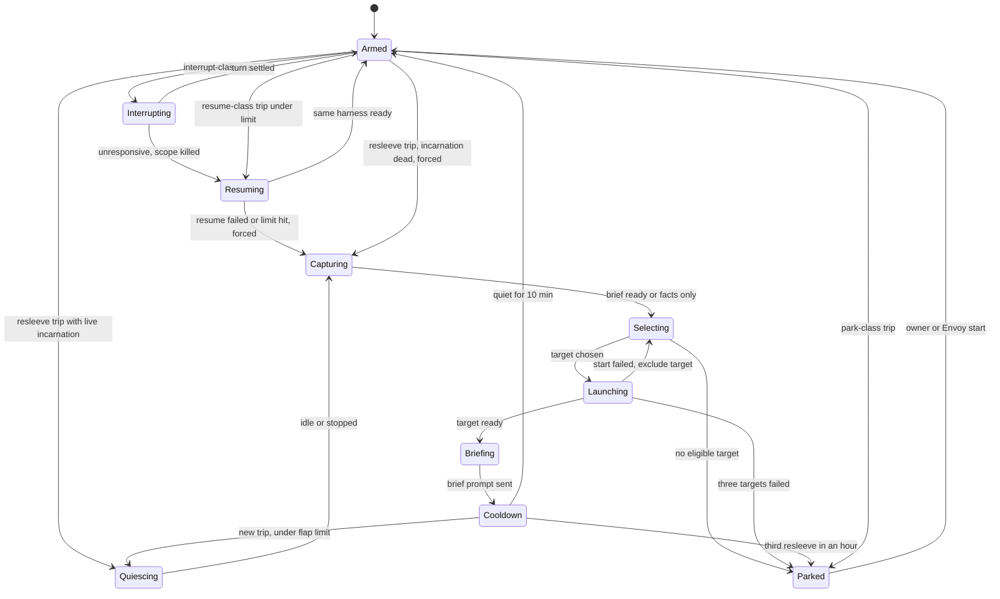
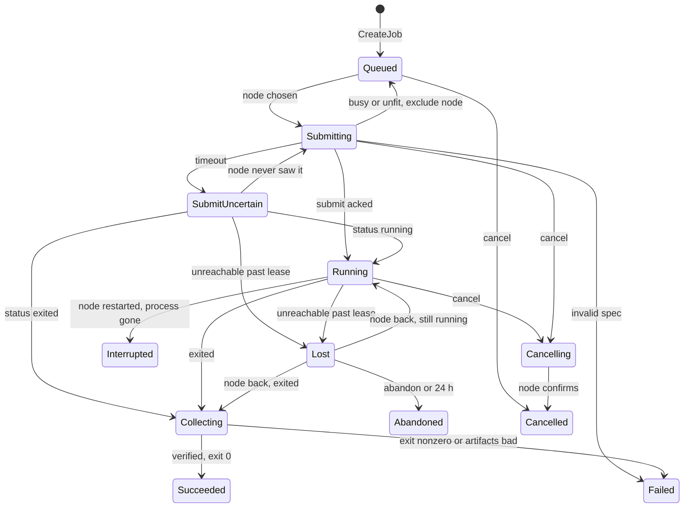

# Sleeves, harnesses, panes and the state machines

Design investigation for the `next` rewrite, 2026-11-01. It covers the sleeve tree, light isolation,
the harness interfaces (including Pi and pi_durable), panes and PTYs, the split between code and
Envoy, guardrails and resleeve, and five state machines. History/continuation and nodes/Verus have
their own reports beside this one (`history-continuation.md`, `nodes-ci-deliverables-verus.md`); this
report uses their interfaces rather than repeating them.

**Evidence:** [V] read in code, in a CLI's `--help` on this hub, or at the cited doc line;
[D] vendor or web documentation only; [I] inference.
**Paths:** `pr/` is `/home/hotschmoe/github/protectorate` (dev-hotschmoe), `agent/` is
`references/agent`, `pi/` is `references/secondary/pi/packages`, `herdr/` is `references/herdr`.

**Correction to the brief:** today's sandbox does not use bwrap. It is our own re-exec helper
(unshare, open_tree/move_mount, pivot_root) inside `systemd-run --user --scope`
[V `pr/ARCHITECTURE.md:141`, `pr/docs/rust-sandbox.md:6`,
`pr/rust/crates/protectorate-sandbox/src/runtime.rs:1109-1130,1557-1588,1861`]; only the Go hub used
bwrap.

---

## 1. Recommendations

### 1.1 Vocabulary (removes the conflation in today's ChatState)

- **Sleeve**: the durable identity (name, `run_id`, workspace claim, parent link, resleeve policy,
  budget, limits, message queue). It outlives every process.
- **Incarnation**: one harness process tree in one sandbox scope, numbered by a per-sleeve
  **generation** `gen` (u64 from 1, +1 per incarnation, never reused). It carries harness, provider,
  model, **mode** (pane or headless) and native session id. Its scope is `pt-<sleeve>-g<gen>.scope`,
  so the cgroup is the ground truth for "is anything of gen g alive".
- **Mode belongs to the incarnation.** Today a sleeve keeps its mode for life
  [V `pr/ARCHITECTURE.md:151-153`]; a forced resleeve from a Claude pane to headless pi_local needs it
  to change.
- **Activity belongs to the incarnation, lifecycle to the sleeve.** Today's `ChatState` mixes them
  (`EXITED` beside `WORKING`), and `CHAT_STATE_FAILED` is never produced: it appears only in the enum
  and the CLI formatter [V `pr/rust/crates/protectorate-wire/src/v1.rs:2573`,
  `protectorate-cli/src/format.rs:871`].

### 1.2 Sleeve tree rules



- **R1. One root per directory, never two.** A writable claim is refused if it equals, contains or
  lies inside another live claim (today's rule, kept [V `pr/rust/crates/protectorate-hub/src/sleeves.rs:124-143`]).
  A second agent on the same repo gets its own clone or worktree: another root, or a child.
- **R2. Children are depth 1, at most 8 live per root.** A child cannot spawn sleeves; it may use its
  harness's native subagents. jessfraz/agent also caps open child agents at 8
  [V `agent/runtime/src/tasks.ts:625`].
- **R3. Child workspace.** Default for git roots is `worktree`:
  `git worktree add $PROTECTORATE_HOME/worktrees/<root>/<child> -b <root>/<child>` from the root's
  HEAD, claiming the worktree path. Objects and refs are shared, so the parent merges with plain git
  and no fetch; git refuses a double checkout of one branch; the sandbox already handles linked
  worktrees [V `pr/docs/sleeves.md:45`]. The alternative is `view`: the root's directory read-only, no
  claim, for reviewers and testers who write only to home and `/tmp`. No shared read-write child, no
  subdirectory claims; non-git roots get `view` children only.
- **R4. Children are tied to the root sleeve, not its incarnation.** Root `Stop`/`Remove` cascades in
  the same `apply` step: every child enters `Stopping(ParentStopped)`, and the root reaches `Stopped`
  only when its incarnation and all children have stopped; Remove removes the children first. Root
  crash, resume, resleeve or park leaves the children running; their reports and mail queue under the
  root's stable name until it has a ready headless incarnation (or show in its pane inbox), and the
  continuation brief lists them. A child crash runs the child's own guardrails, and the root gets a
  notice when it parks or stops. Why: "die with the parent" should mean the end of the parent's
  lifecycle; a crash is transient by design, and killing children then wastes paid work.
  jessfraz/agent also keeps children's conversations when it reopens a parent
  [V `agent/runtime/src/tasks.ts:896-912`].
- **R5. Who may spawn.** Roots: the owner (app, CLI), Envoy, and external general agents (GrokBot,
  Claude Duet, Dots) through CLI or MCP with a device-issued capability, all through dispatch code
  (1.8). Children: the root itself (`protectorate sleeve spawn --child`, its capability scoped to its
  own children), Envoy naming the root, or the owner; never a child. A child's budget is at most the
  root's remainder and counts against both, as today [V `pr/docs/sleeves.md:229-232`].
- **R6.** Envoy is an ordinary root on its own workspace, as today
  [V `pr/proto/protectorate/v1/sleeve.proto:93-103`].

### 1.3 Native subagents versus child sleeves

Verified on this hub: Claude Code's Task tool and `--agents` [V `claude --help`], Codex `multi_agent`
(stable, enabled) [V `codex features list`], Grok `--agents`/`--no-subagents` [V `grok --help`]. Pi
has none [V `pi/coding-agent/docs/cli.md:140-155`]. Native subagents run inside the parent
incarnation's sandbox and cgroup, on the same directory. We do not enable, disable, count or display
them (hands-off); their tokens show up in the harness's usage reports and their activity as the
parent's `Working`. Use a **child sleeve** for another harness or provider (spreading quota), its own
worktree, budget and guardrails, a life longer than one turn, or its own pane. Use **native
subagents** for parallel reading and search inside one turn of one harness.

### 1.4 Light isolation: keep, change, cut

The goal is that agents do not stomp on each other by accident. It is not a boundary against a
hostile agent.

| Today [V] | Decision | Why |
|---|---|---|
| User ns, then mount+PID+IPC+UTS+net ns in a single-threaded helper (`runtime.rs:1557-1588`) | **Keep** user, mount, PID, IPC, UTS. **Cut** net | The PID namespace is P8 itself. The user namespace makes the rest unprivileged |
| Fresh tmpfs root with an allowlist of tool binds and `pivot_root` (`runtime.rs:1861`); tool-root discovery and rustup/flutter special cases (`protectorate-sleeve-runner/src/lib.rs:76-110,322-740`) | **Change**: bind host `/` read-only; workspace and private home read-write; `/tmp` a sized tmpfs; tmpfs masks over `$PROTECTORATE_HOME`, `~/.ssh`, other harnesses' credential dirs and other sleeves' homes | Toolchains just work read-only, which ends the breakage class in `pr/docs/dogfood-2026-10-20.md:153-202`. The masks stop an agent from reading the owner token into a transcript by accident |
| `systemd-run --user --scope` with TasksMax, CPUQuota, MemoryMax, MemorySwapMax=0 (`runtime.rs:1109-1130`); `cgroup.kill` (`:345-371`); orphan scope reaper (`:596-604`) | **Keep** | Limits, accounting and "kill all of gen g" make the probes in section 2 deterministic |
| setsid, close_range, PDEATHSIG (`runtime.rs:1167-1180`) | **Keep** setsid and close_range. **Drop** PDEATHSIG for sleeves (P8 in 1.6) | PDEATHSIG kills the incarnation when the forking thread exits, which rules out the fd handoff. After a crash, cleanup comes from pipe EOF, PTY hangup and the reaper |
| tmpfs sized from the memory allowance (`runtime.rs:205-235`) | **Keep** | It fixed a real Go build failure (`pr/docs/rust-sandbox.md:21`) |
| Egress CONNECT proxy, per-provider allowlists, egress audit (`lib.rs:152-377`, `egress.rs`) | **Cut**: sleeves share the host network, with an advisory per-sleeve `PROTECTORATE_PORT_BASE` | It is a security feature, not stomp prevention (D4) |
| Cache overlays for flutter, pub and go mod (`sleeve-runner/src/lib.rs:322-700`) | **Cut**: bind the owner's download caches (cargo, go mod, pub, npm) read-write and shared | Content-addressed and lock-protected [I]; it also saves disk (P9). D3 |
| Nested cgroup delegation (`pr/docs/sleeves.md:322-343`) | **Cut** | Children are hub-launched sibling scopes. Delegation only served our own runtime tests inside a sleeve |
| Harness and profile SHA-256 pins with approval on change (`sleeve.proto:301-308`) | **Change**: record the hashes on the incarnation, with no approval gate | The gate is a security control |
| Disk sampler that stops at 100% (`sleeve.proto:218-223`) | **Keep** (hub side) | P9 |

Size: sandbox plus runner is about 4.8k source lines (`runtime.rs` 2072, `lib.rs` 1457, `egress.rs`
422, runner 877); the light profile needs about 1.2k [I]. bwrap is rejected: a host dependency whose
versions differ (0.8 has no overlays [V `pr/docs/dogfood-2026-10-20.md:153-155`]), and trimming our
tested helper is cheaper. The helper's FFI conflicts with Verus rule 6; the nodes report raises the
same exemption, and this report agrees (D7).

### 1.5 Harnesses: interface and deterministic signals

Hands-off means the TUI or the official headless protocol only, with the harness's own config and
auth. Paths in this table are under `pr/rust/crates/` unless they start with `pi/`.

| Harness | Mode, interface | Ready | Prompt ack (Sent to Confirmed) | Turn end | Approval | Steer | Interrupt | Session id |
|---|---|---|---|---|---|---|---|---|
| Claude Code | headless: `claude -p --input-format stream-json --output-format stream-json --permission-prompt-tool stdio` [V `protectorate-hub/src/chat.rs:1332-1370`] | `system/init` with session_id [V `protectorate-claude-driver/src/lib.rs:296-305`] | **add** `--replay-user-messages`, which echoes stdin user messages [V `claude --help`; not passed today] | `result` with stop_reason and is_error [V `:447-492`] | `control_request can_use_tool` [V `:411-446`] | none: the driver refuses a busy Send [V `:158-160`], so the hub queues | `control_request interrupt` [V `:183-184`] | we assign `--session-id` [V `chat.rs:1370`] |
| Codex | headless: `codex app-server` JSON-RPC | `thread/start` or `thread/resume` result [V `protectorate-codex-driver/src/lib.rs:209-221`] | `turn/start` result with turn.id [V `:393-395`] | `turn/completed` (completed, interrupted, failed) [V `:804-840`] | `item/{commandExecution,fileChange,permissions}/requestApproval` [V `:647-690`] | `turn/steer` with `expectedTurnId`, a native fence [V `:366-370`] | `turn/interrupt` [V `:420`] | thread id; `codex resume <id>` for the TUI [V] |
| Grok Build | headless: `grok agent stdio` (ACP) | `session/new` or `session/load` [V `protectorate-grok-driver/src/lib.rs:307-345`] | first `session/update` after the prompt [I] | `session/prompt` response with stopReason [V `:464-512`] | `session/request_permission` [V `:589-640`] | none: hub queue | `session/cancel` [V `:257`] | ACP sessionId; `grok -s <uuid>` for the TUI [V] |
| Pi CLI | headless: `pi --mode rpc` JSONL | `get_state` [V `protectorate-pi-driver/src/lib.rs:136-140`] | `prompt` response `disposition` [V `pi/coding-agent/docs/rpc-commands.md:40`] | `agent_settled {aborted}` [V `pi/coding-agent/docs/json.md:45-56`] | none: Pi has no gate | `steer`, or `prompt` with `streamingBehavior` [V `rpc-commands.md:20-29`] | `abort` [V `pi-driver:439`] | `--session-id` [V `pi/coding-agent/docs/cli.md:86-107`] |
| Gemini CLI | headless: `gemini --experimental-acp` [D geminicli.com cli-reference], reusing the ACP driver; not installed here [V] | ACP [I] | ACP [I] | ACP [I] | ACP permission [I] | none | `session/cancel` [I] | `--resume <id>` [D] |
| Antigravity `agy` | **pane by default.** Headless `agy -p --input-format stream-json --output-format stream-json` exists [D antigravity.google/docs/cli/headless] | `init` [D] | `step_update` `user_input` [D] | `result`, state `DONE` [D] | **none**: `control_request` is rejected; tools are soft-denied unless `--dangerously-skip-permissions` [D] | none | undocumented | `--conversation <id>` [D]. Policy unclear (D5) |
| Any TUI | pane: PTY | screen rule | n/a: the hub never types | screen rule | screen "blocked" rule | n/a | owner keys only | assigned at launch where a flag exists (Claude, Grok, Pi); for Codex, the only session in the sleeve's private `CODEX_HOME` [I] |

Three findings in today's drivers, all fixed by this design:
- **A hub-composed prompt switches Grok's autonomy:** `/always-approve on` sent through
  `session/prompt` [V `grok-driver:347-361`, reason at `:76-78`]. `grok agent --always-approve` now
  exists [V `grok agent --help`]; use it, and omit it when supervised (verify that the default asks).
- **Every driver writes to stdin before recording the user event** (dispatch before record)
  [V `claude-driver:162-167`, `codex-driver:373-381`, `pi-driver:419-425`].
- **A Codex `turn/start` timeout counts as "not started":** after 15 s the driver sets busy=false and
  IDLE [V `codex-driver:27,397-404`], treating an uncertain effect as a rejection.

### 1.6 Panes and PTYs

- **P1. The hub owns every PTY and pipe; tmux goes.** Today the hub polls tmux `capture-pane` every
  second and announces after two agreeing scans
  [V `pr/rust/crates/protectorate-hub/src/session_monitor.rs:15,23-27`].
- **P2. Per pane:** the PTY master, a 4 MiB raw output ring with monotonic u64 byte offsets, and a Rust
  VT screen model (`vt100` or `alacritty_terminal`) used only for status rules and attach snapshots.
  herdr embeds libghostty-vt (Zig) and renders cells on the server
  [V `herdr/crates/ghostty-vt`, `herdr/src/protocol/wire.rs:1268-1338`]; we need neither, because
  Flutter's xterm.dart is a full emulator.
- **P3. Client WebSocket:** `attach(pane, from_offset)` sends bytes from that offset while it is still
  in the ring, otherwise an ANSI screen snapshot plus its offset; live bytes follow, tagged with
  offsets. Input from all clients is applied in the order the core receives it; the size follows the
  client that last typed or resized.
- **P4. Status comes from screen rules only, re-evaluated on screen damage.** Keep our Rust rule
  tables [V `pr/rust/crates/protectorate-session/src/activity.rs:61-113`], add herdr's regions (bottom
  non-empty lines, prompt box, OSC title) and priorities, and port herdr's manifests (Apache-2.0
  [V `herdr/LICENSE`]) for claude, codex, grok, pi, gemini and agy. Take herdr's debounce
  [V `herdr/src/pane/agent_detection.rs:5-12,39-78`]: a 300 ms tick; Working to plain Idle needs 3
  confirmations (at most 700 ms); visible prompt and blocker screens skip that hold; 3 s startup grace.
  No match means `Unknown`; herdr falls back to Idle [V `herdr/src/detect/manifest.rs:431-475`], which
  would show false DONE badges. **No hooks**: herdr uses Claude and Codex hooks only for session
  identity [V `herdr/src/agent_resume.rs:163-175`], and installing them edits `~/.claude/settings.json`
  [V `herdr/src/integration/claude_settings.rs:26-95`]. We assign session ids at launch instead.
- **P5. The hub never writes to a TUI PTY on its own:** no auto-prompts, no send-keys, no typed resume
  commands. herdr types `claude --resume <id>` into a shell
  [V `herdr/src/app/agent_resume.rs:266-300`]; we exec that argv directly. A pane's brief is the
  official positional prompt argument at launch, or nothing. Mail to a pane sleeve goes to its inbox
  with a badge, and the agent reads it with `protectorate mail inbox`.
- **P6. Headless panes render the chat log**, with the same chrome and badge.
- **P7. Badges:** herdr's WORKING, BLOCKED, IDLE, DONE (Idle and not yet seen; seen is cleared on
  Working to Idle unless the pane is focused [V `herdr/src/app/actions.rs:22-25,1844-1848`]) and
  UNKNOWN, plus the lifecycle badges STARTING, RECOVERING, RESLEEVING, PARKED and STOPPED.
  `SleeveService.Wait(until in {idle, done, blocked, report, ended, parked})` reads the core's state
  channel; herdr's `agent.wait` polls every 100 ms [V `herdr/src/api/wait.rs:364-514`].
- **P8. Hub restarts.**
  - Planned update: the hub flushes the journal, writes each pane's ring and screen snapshot to a
    memfd, clears CLOEXEC on the sleeve fds and `execve`s the new binary in place, so systemd sees the
    same PID. State comes back from the journal, so only fds cross. herdr already hands PTY fds to a
    successor for live upgrades [V `herdr/src/handoff_runtime.rs:4-32`, `src/server/handoff.rs:25-55`].
  - Crash: the fds close, headless harnesses see stdin EOF (documented by Pi
    [V `pi/coding-agent/docs/rpc.md:93`]), TUIs get SIGHUP, and the reaper kills whatever is left.
    Every incarnation goes to `Recovering` and resumes natively.
  - Today tmux terminal sleeves survive hub restarts while chat sleeves die with the hub (PDEATHSIG,
    then `recover_chat_sleeves` [V `chat.rs:1009-1027`]). Without P8, pane sleeves would regress (D10).

### 1.7 Pi and pi_durable

The harness was removed on 2026-11-02; this section is kept for the owner's revisit, and SPEC.md is current.

**What pi_durable is** [V, under `pi/durable`]. An Experimental library with no `bin`
(`README.md:3`). It commits before display: streamed partials at most every 100 ms
(`src/harness/generation.ts:446-483`), and a tool-intent checkpoint before `execute()`
(`src/harness/tool.ts:166-176`). After a restart:
- a cut stream is resent from the same messages (`generation.ts:422-431`);
- a cut tool reruns only if its stored and current `replay` are both `safe`, otherwise the model
  receives "interrupted and may have partially run" (`tool.ts:178-196`); calls that never started are
  `abandoned` (`:200-206`); the built-in read/write/edit/bash tools default to `unsafe`
  (`types.ts:303-304`).

A resubmitted `requestId` returns the existing submission (`README.md:120-126`), and a task interrupted
5 times is parked (`:206`). It also has fork, child conversations, a task graph, handoff and compaction
(`:529-714`). Storage is SQLite through `node:sqlite`, WAL, `synchronous=NORMAL`, so power loss can drop
the newest commit (`:750-755`); one process per store (`:774`); "not exactly-once execution"
(`types.ts:271-272`). The `pi` CLI does not use it: its modes are text, json and rpc
(`coding-agent/src/cli/args.ts:11`), and plain pi emits events before an un-fsynced `appendFileSync`,
so a crash loses the in-flight message (`coding-agent/src/core/agent-session.ts:1144-1166`). Runtime:
Node >= 22.19; a Bun-compiled `pi` with side files exists (`scripts/build-binaries.sh:40-80`).

**Tier 1 (now): the `pi` CLI in rpc mode as an ordinary headless harness.** Profiles:

| Profile | Login | Status |
|---|---|---|
| `pi_local` | `models.json` custom provider pointing at the local OpenAI-compatible server [V `pi/coding-agent/docs/models.md:45-65`] | yes |
| `pi_grok` | xAI device code, scope `grok-cli:access` [V `pi/ai/src/auth/oauth/xai.ts:1-14`] | yes; xAI allows it per P5 |
| `pi_openai` | ChatGPT sign-in; `openai-codex` is legacy [V `pi/ai/src/providers/openai-codex.ts:9-10`] | yes |
| `pi_claude` | Anthropic login | works, but bills as extra usage, and the UI says so [V `pr/PROBLEMS.md` P5] |
| Gemini or Antigravity | none | not offered: removed upstream, and a ban risk |

Ship the Bun-compiled pi so the hub needs no Node. Today this hub runs pi through a private Node
install (`~/.local/bin/pi` sets PATH to `pi-omp-setup/node/bin`) [V]. Verify that the side files
load inside the sandbox.

**Tier 2 (time-boxed experiment): a `pi_durable` harness.** Our own small TypeScript bridge on
durable's `Harness`, following jessfraz/agent: `node bridge.js <state>`
[V `agent/src/runtime.rs:131-139`], JSONL frames with a protocol version
[V `agent/src/protocol.rs:14`], each frame validated against schemas generated from our proto
[V `agent/runtime/src/protocol.ts:1-40`], and `synchronous=FULL` as agent sets it
[V `agent/runtime/src/bridge.ts:103-108`]. Auth is pi's `auth.json` through
`createModels({credentials})`, so a PI_GROK sleeve uses the same login. Because the harness is ours,
hands-off does not apply, but it does make Node a hub dependency (D6).

**"rust + pi_durable":** the Rust hub is the single writer of orchestration state, and the durable
process is the authority for its conversations. The boundary is the effect id: hub `effect_id` =
durable `requestId`. That makes `SendPrompt` Keyed instead of Unsafe (2.c): the probe is
`submission(requestId)` and a retry is safe. A crash mid-turn resumes the turn, and a cut tool reaches
the model as `interrupted`. It does not give exactly-once tools, cross-harness continuation (the
history report's job) or multi-process access.

**Acceptance test.** SIGKILL the bridge mid-stream, mid-bash, and after bash but before its commit,
and compare with `pi --mode rpc` under the same kills. durable's own recovery tests only `close()` and
reopen [V `durable/test/harness-*-recovery.test.ts`]. Adopt it only if all three resume correctly and
the bridge stays around 500 lines [I].

### 1.8 Code decides, Envoy decides

| Code (deterministic, journaled, fuzzed) | Envoy (LLM judgment) |
|---|---|
| Dispatch by quota: `select_target(task_size, allow, mode, exclude, quota, health)`. Fresh data only; projected unused at reset; 48 h urgency half-life; local fallback score [V `pr/rust/crates/protectorate-quota/src/suggest.rs:9-14,47-53`] | Goal decomposition, briefs, choice of repo and workspace, whether to use children |
| Retries, backoff, probes, idempotency | The `task_size` estimate and optional harness constraints fed to dispatch |
| Every guardrail and its action, resleeve execution, target choice, flap limits | Reading reports: accept, rework or escalate |
| Mail delivery, re-delivery and escalation [V `pr/proto/protectorate/v1/message.proto:13-23`]; the steer and queue rules | Answering sleeves' questions and mail |
| Child cascade, budget split, approval routing and timeouts | Reviewing diffs and PRs |
| Node scheduling (tier, arch, toolchain, load, human present); job submit, poll and collect | Which backlog item spare quota goes to (the P6 trigger itself is code) |
| Checkpoints, worktree and branch names, handoff facts | Manual resleeve requests (no approval needed, per the orchestrator-autonomy memory) |

Envoy never ranks harnesses, retries, kills on a timeout or runs a guardrail resleeve. The code
never resleeves a healthy idle sleeve just because another subscription has more spare quota; that
would bust its prompt cache for nothing. Dispatch by quota runs only at spawn and at guardrail time.

### 1.9 Correctness patterns adopted from jessfraz/agent

| Pattern | There [V] | Here |
|---|---|---|
| Uncertain effects | `WorkerState {Unassigned, Allocating, Bound, Resuming, ResumeUncertain, Uncertain}` (`agent/src/protocol.rs:566-592`); `Stage {Waiting, Sending, Uncertain, Accepted, Placed, Rejected, Canceled}` (`agent/src/chat_admission.rs:10-19`) | Effect record (2.c); `Launching` resolves by scope probe |
| Record before dispatch | Allocation saved before spawn (`tasks.ts:870-876`); input outbox committed first (`:580-596`) | `Intent` is fsynced before any byte reaches a harness or node (I7) |
| Idempotent ids, reuse with other content refused | `input_id` becomes the Pi `requestId`; a mismatch throws (`tasks.ts:565-569`) | `effect_id` = client `request_id` plus a payload digest, kept in the journal. Today's window is in memory only [V `pr/rust/crates/protectorate-hub/src/chat.rs:285-345`] |
| Generation fencing | Broker peer generation (`agent/src/broker.rs:23-29,121-166`); `allocation_id` checks (`tasks.ts:787-791`) | Per-sleeve `gen` on every effect and observation; per-job `attempt` |
| Never resend uncertain input | `chat_admission.rs`, `main.rs:1636-1645` | Unsafe effects never retry out of `Uncertain` (I8) |
| Steer versus queue | `InputMode {Steer, FollowUp}` (`protocol.rs:1322-1326`) | `Send.mode` (2.b), with no silent downgrade |
| Single writer | One actor owns the child's pipes (`agent/src/runtime.rs:424-446`), plus a flock (`:120-156`) | One core task (1.10) |
| Dead end to avoid | `Uncertain` with a known session id has no exit (agent report: every write grepped) | Every uncertain state has a probe, a fence or `Abandon` |

### 1.10 One writer, one journal, pure apply

One core task owns all orchestration state: sleeves, incarnations, activity, queue, effects,
guardrails and jobs. Drivers, PTY readers, RPC handlers and node pollers are I/O tasks: they parse and
send `Observation{sleeve, gen, ..}` or requests into one bounded mpsc, and never mutate state. Per
event the core (1) runs `apply(&State, Event) -> (State, Vec<EffectIntent>)`, (2) journals the event
and intents (group commit, one fsync per batch), (3) publishes the new `Arc<State>` on a watch
channel, (4) hands the intents to executors. Time arrives as `Tick{now}` events, so a replay is exact.
This replaces several stores with their own locks, written from driver and RPC threads
[V `Hub` fields `sleeve_launch_lock`, `resleeving`, `envoy_spawn_lock` in
`pr/rust/crates/protectorate-hub/src/lib.rs`; driver threads call `log.append`].

---

## 2. State machines

Conventions: `g` is the sleeve's current gen. Every machine below drops and logs any observation whose
gen is not `g` (fencing). "Live" means Provisioning, Launching, Running, Recovering, Resleeving or
Parked.

### 2.a Sleeve lifecycle (with parent/child coupling)

States: `Provisioning`, `Launching(g)`, `Running(g)`, `Recovering(g)`, `Resleeving(g)`, `Stopping`,
`Stopped`, `Parked(reason)`, `Removed`.

| From | Event | Guard | To | Effects |
|---|---|---|---|---|
| (none) | `Spawn(spec, request_id)` | name and claim free (R1); for a child: parent not Stopping, Stopped or Removed; parent is a root; fewer than 8 live children; budget left | Provisioning | `Provision(layout)` |
| Provisioning | `ProvisionDone` | | Launching(1) | `StartIncarnation(1)` |
| Provisioning | `ProvisionFailed(e)` | | Parked(provision) | notify the requester; nothing deleted |
| Launching(g) | `IncarnationReady(g)` | | Running(g) | `DeliverQueue(g)` |
| Launching(g) | `IncarnationFailed(g, cause)` | | Recovering(g) | guardrails (2.d) |
| Running(g) | `IncarnationExited(g, requested=false)`, or `HubRecovered` with probe(g) gone | | Recovering(g) | guardrails; notice to the parent if this is a child |
| Running(g) | resleeve-class trip or `Resleeve(target)` | | Resleeving(g) | 2.d |
| Recovering(g) | `Decide(Resume)` | | Launching(g+1) | `StartIncarnation(g+1, native resume)` |
| Recovering(g) | `Decide(Resleeve)` | | Resleeving(g) | 2.d, forced |
| Resleeving(g) | `ResleeveDone(g')` | g' > g | Running(g') | `DeliverQueue(g')` |
| Recovering, Resleeving | `Decide(Park, r)` | | Parked(r) | notify the owner and the parent |
| Parked, Stopped | `Start(target?)` | for a child: parent not Stopping, Stopped or Removed | Launching(g+1) | `StartIncarnation(g+1)` |
| any Live | `Stop(reason)` | | Stopping | `StopIncarnation(g)` if alive; `Stop(c, ParentStopped)` for every live child, applied in the same step |
| Stopping | `IncarnationExited(g)` or `ChildStopped(c)` | | Stopped once the incarnation is dead and every child is Stopped or Removed | |
| Stopping | `Tick` 30 s after Stop | | Stopping | `KillScope(g)` (`cgroup.kill`) |
| Stopped | `Remove` | children Removed first (cascade) | Removed | release the claim; archive the record; worktrees stay until an explicit prune |



Invariants checked by the fuzz target:
- **I1** The parent of a non-Removed child is not Removed.
- **I2** If a parent is Stopping, Stopped or Removed, so is every child.
- **I3** Depth is at most 1, with at most 8 live children.
- **I4** Writable claims of non-Removed sleeves never overlap.
- **I5** At most one incarnation per sleeve is not known dead. `StartIncarnation(g+1)` is emitted only
  after gen g is confirmed dead or proven never started.
- **I6** gen only increases, and no effect for gen g is emitted once gen > g.

### 2.b Activity (turn state; unifies headless ChatState and pane status)

States: `Booting`, `Idle{seen}`, `Working{turn, native_turn?, compacting}`,
`Blocked{turn, approvals}`, `Interrupting{turn}`, `Compacting`, `Unknown`, `Ended`. The queue lives
on the sleeve, so it survives incarnations and resleeves.

Headless transitions (protocol observations are authoritative):

| From | Event | Guard | To | Effects |
|---|---|---|---|---|
| Booting | `Ready` | | Idle | `DeliverNext` if the queue is non-empty |
| Booting | `Tick` 60 s after boot | | Booting | trip G5 |
| Idle | `Send(m, queue or steer)` | queue empty | Working(turn=m) | `SendPrompt(m)` |
| Idle | `Send(m, queue)` | queue not empty | Idle | enqueue, then `DeliverNext` (FIFO) |
| Working | `Send(m, steer)` | harness steers; native turn bound | Working | `Steer(m, expected_turn)` |
| Working | `Send(m, steer)` | harness steers; turn not yet acked | Working | hold m in the steer slot until `TurnAck`; if the turn settles first, m goes to the head of the queue |
| Working | `Send(m, steer)` | harness cannot steer | Working | FailedPrecondition; the caller decides whether to queue |
| Working, Blocked, Compacting, Interrupting, Booting, Unknown | `Send(m, queue)` | | unchanged | enqueue |
| Working | `TurnAck(native)` | | Working | bind native turn; effect Confirmed |
| Working | `Progress` (text, tool call or result) | | Working | `last_progress = now` |
| Working | `NativeCompaction(start/end)` | | Working, compacting flag toggled | |
| Working | `ApprovalRequested(id)` | supervised | Blocked | notify the owner |
| Blocked | `ApprovalResolved(id)` | none left pending | Working | |
| Working, Blocked | `Interrupt` | | Interrupting | `NativeInterrupt` |
| Working, Blocked, Interrupting | `TurnSettled(end)` | | Idle{seen=false} | `Checkpoint`; `DeliverNext` |
| Idle | `Compact` (explicit request only) | | Compacting | `NativeCompact` |
| Compacting | `CompactDone` or `CompactFailed` | | Idle | `DeliverNext` |
| any | `ProtocolDesync` (oversize frame, session id mismatch) | | Unknown | trip G14 |
| any | `ProcessExited` | | Ended | goes up to 2.a |
| Idle | `Viewed` | | Idle{seen=true} | |

Pane mode is a pure merge over observations, first match wins: exited gives `Ended`; inside the 3 s
grace gives `Booting`; otherwise the debounced screen verdict (P4), where Blocked publishes at once,
Working to plain Idle needs 3 confirmations, and no match gives `Unknown`. `Send` to a pane fails with
FailedPrecondition and the message goes to the inbox (P5). Compaction stays native: the hub compacts
only when explicitly asked (today Claude's driver sends `/compact` as a user message
[V `claude-driver:225`]).



Mapping from today's enums:

| Today | Activity |
|---|---|
| `AWAITING_APPROVAL` | Blocked |
| `WORKING` | Working |
| `COMPACTING` | Compacting, or Working with the compacting flag |
| `IDLE` | Idle |
| `FAILED` | deleted (never produced) |
| `EXITED` | Ended, with the sleeve moving to Recovering or Stopped |
| `TERMINAL_ACTIVITY_*` | Working, Blocked, Idle, Unknown |
| DONE | Idle with seen=false |

### 2.c Dispatch / effect record

Each record holds `effect_id` (the client `request_id`, or `<kind>:<sleeve>:<gen>:<n>`), kind, target
((sleeve, gen) or (job, attempt)), payload digest, retry class, attempt and deadline. States: `Intent`, `Sent`, `Confirmed`, `Rejected`, `Uncertain`, `Probing`, `NotApplied`, `Failed`,
`Fenced`, `Abandoned`. Confirmed, Rejected, Failed, Fenced and Abandoned are terminal.

| From | Event | Guard | To | Effects |
|---|---|---|---|---|
| (none) | apply emits the intent | | Intent | fsynced before dispatch |
| Intent | `Dispatched` | | Sent | |
| Intent | `HubRecovered` | | Uncertain | the crash may have fallen between the write and the record |
| Sent | `Ack(evidence)` (table 1.5) | | Confirmed | answer the requester |
| Sent | `Nack(definitive)`: an error that guarantees nothing was applied | | Rejected | answer the requester |
| Sent | `AckTimeout`, `ChannelLost` or `HubRecovered` | | Uncertain | the requester gets UNCERTAIN plus the `effect_id` |
| Uncertain | `ProbeStart` | the kind has a probe | Probing | `Probe` |
| Probing | `ProbeApplied` / `ProbeNotApplied` / `ProbeUnknowable` | | Confirmed / NotApplied / Uncertain (notify after 3) | |
| NotApplied | (immediate) | attempt < max | Intent(attempt+1), same `effect_id` | |
| NotApplied | (immediate) | attempt = max | Failed | |
| Uncertain | `Retry` | class Idempotent or Keyed | Intent(attempt+1) | |
| Intent, Sent, Uncertain, Probing | `GenAdvanced` (the target incarnation is dead) | | Fenced | the brief lists it as "may have been applied" |
| Uncertain | `Abandon(by)` (owner or guardrail) | | Abandoned | audited |
| any | client retry with the same `request_id` | equal digest / different digest | unchanged | return the record / InvalidArgument |

| Kind | Class | Probe |
|---|---|---|
| StartIncarnation(g) | Keyed (scope name) | the scope `pt-<sleeve>-g<g>` has tasks: Applied; absent: NotApplied |
| SendPrompt or Steer to a vendor CLI | Unsafe | harness ack (1.5); otherwise native state (Pi `get_entries since`; Codex thread state [I]); a dead incarnation means Fenced |
| SendPrompt to pi_durable | Keyed | `submission(requestId)` |
| RespondApproval(id) | Unsafe, probeable | still pending: NotApplied; gone: Applied |
| Interrupt, StopIncarnation, KillScope | Idempotent | settled, or scope gone |
| Provision (worktree add) | Idempotent with check | `git worktree list` shows the path on the expected branch |
| NodeSubmit(job, attempt) | Keyed | the node's `Status(job, attempt)` |
| ContinuationBrief(sleeve, to_gen) | Keyed | the brief id exists |



Invariants:
- **I7** Every Sent, Uncertain or Confirmed record has an earlier Intent in the journal.
- **I8** An Unsafe effect never goes from Uncertain back to Intent.
- **I9** No queued message is delivered twice (by `effect_id`) across incarnations, and none vanishes
  unless it is Fenced or Abandoned and shown to the owner.

### 2.d Guardrails and resleeve

Guardrails are pure predicates: `evaluate(view, now) -> Option<Trip>`. `view` is the sleeve,
incarnation, activity, usage, quota snapshot and health. They run on every relevant event and on a
10 s `Tick`. The values below are defaults (D9).

| Id | Predicate | Source | Action |
|---|---|---|---|
| G1 quota_exhausted | fresh quota shows a window at 100% or more, or a turn error is classified usage_limit or rate_limit | quota reader, driver | Resleeve; the provider is excluded until its reset_at |
| G2 auth_failed | the driver classifies an auth or login-required error | driver | Resleeve; the provider is unhealthy until re-login; notify |
| G3 crash | unrequested exit, not OOM | scope, pipe EOF | Resume (at most 2 per 10 min), then forced Resleeve |
| G4 oom | SIGKILL plus an `oom_kill` increment in the cgroup | cgroup | Resume once with a factual note; the second one Parks |
| G5 start_failed | not Ready within 60 s, or exited while Booting | activity | Resleeve; the harness is excluded for 30 min |
| G6 silent | Working with no Progress for 15 min (pane: screen unchanged for 15 min) | activity | Interrupt; 2 strikes in an hour mean Resleeve. Pane: notify only |
| G7 loop | 6 or more consecutive tool calls with identical (name, input hash) | tool events | Interrupt; 2 strikes mean Resleeve |
| G8 turn_wallclock | one turn Working for more than 90 min | activity | Interrupt and notify |
| G9 approval_timeout | Blocked on an approval for more than 30 min (supervised) | activity | Deny with a note through the official respond; notify |
| G10 budget | `tokens_used >= token_budget` | usage | Interrupt and Park, as today [V `pr/docs/sleeves.md:222-229`] |
| G11 forbidden_path | at settle, the diff against the pre-turn checkpoint touches deny globs (`.git/hooks/**`, `.github/workflows/**`, `**/.env*`) | checkpoint diff | Park and notify; keep the diff; no auto-revert |
| G12 disk_limit | sampled usage at or above disk_bytes | sampler | Stop and Park |
| G13 interrupt_unresponsive | Interrupting for more than 30 s | activity | KillScope, then the G3 path |
| G14 protocol_desync | oversize or unparseable frame, or session id mismatch | driver | KillScope, then the G3 path |

Pane incarnations can trip only G3, G4, G5, G6 (notify), G11, G12 and G13 (stop instead of
interrupt), because the hub never types into them. Automatic resleeves always target headless mode.

**Target selection is pure.** Walk the sleeve's ordered `resleeve_to` list (default `[pi_local]`, as
the owner said; an `auto` entry expands to the dispatch ranking of 1.8). Skip targets that are
unhealthy, excluded, already tried or below the task-size minimum (5, 15 or 30%
[V `suggest.rs:47-53`]). The first eligible target wins; with none, Park. `pi_local` only needs its
model host to answer.

States: `Armed`, `Interrupting`, `Resuming`, `Quiescing`, `Capturing`, `Selecting`, `Launching`,
`Briefing`, `Cooldown`, `Parked`.

| From | Event | Guard | To | Effects |
|---|---|---|---|---|
| Armed | interrupt-class trip | fewer than 2 strikes in 1 h | Interrupting | `Interrupt`; notice in the log |
| Armed | interrupt-class trip | 2 or more strikes | Quiescing | escalates to resleeve |
| Interrupting | TurnSettled | | Armed | strike + 1 |
| Interrupting | `Tick` 30 s | | Resuming | `KillScope(g)` (G13) |
| Armed | resume-class trip (G3, first G4, hub restart) | fewer than 2 resumes in 10 min | Resuming | sleeve goes to Launching(g+1) on the same harness and native session |
| Resuming | IncarnationReady | | Armed | resumes + 1 |
| Resuming | IncarnationFailed, or resume limit reached | | Capturing(forced) | |
| Armed | resleeve-class trip or manual `Resleeve` | incarnation alive | Quiescing(deadline = wait, 5 min by default) | sleeve goes to Resleeving; Sends are queued |
| Armed | resleeve-class trip | incarnation dead | Capturing(forced) | |
| Quiescing | Idle or Ended | | Capturing(planned) | `StopIncarnation(g)` first, so the workspace stays still |
| Quiescing | deadline | | Quiescing | `Interrupt`; after 30 s more, `StopIncarnation` |
| Capturing | entry | | Capturing | `Checkpoint`; `ContinuationBrief(sleeve, g, trigger, planned or forced)` (section 4) |
| Capturing | `BriefReady(ref)` or `BriefFailed` | | Selecting | facts-only brief if it failed |
| Selecting | entry | `select_target` returns t / returns None | Launching(t, g+1) / Parked(no_target) | `StartIncarnation(g+1, t)` / notify the owner and Envoy |
| Launching | IncarnationReady | | Briefing | `SendPrompt` with key `resleeve:<name>:<g+1>`, pointing at BRIEF.md |
| Launching | IncarnationFailed | fewer than 3 targets tried / 3 tried | Selecting with t excluded / Parked(launch) | |
| Briefing | effect Confirmed | | Cooldown(10 min) | sleeve goes to Running(g+1); `DeliverQueue` |
| Briefing | effect Uncertain or Fenced | | Cooldown | no resend (Unsafe); notify if Unknowable |
| Cooldown | resleeve-class trip | 3 or more resleeves in the last hour | Parked(flapping) | |
| Cooldown | resleeve-class trip | fewer than 3 | Quiescing or Capturing | earlier targets excluded for the same cause |
| Cooldown | `Tick` at the deadline | | Armed | |
| Armed | park-class trip (G10, G11, G12, second G4) | | Parked | sleeve goes to Parked |
| Armed | G9 | | Armed | `RespondApproval(deny, note)` |
| Parked | `Start(target)` from the owner or Envoy | | Armed | sleeve goes to Launching |

A forced resleeve (crash, no live incarnation, no handoff) skips Quiescing and follows the same
Capturing path with `forced`: no model summary, and the brief lists Fenced and Uncertain effects as
"may have been applied: verify". Neither path asks the outgoing harness anything, which is already
true today [V `pr/ARCHITECTURE.md:165`].

Today a resleeve is one synchronous RPC with no persisted progress [V `pr/.../sleeves.rs:265-423`]. A
hub crash between the kill (`:354`) and the spawn (`:356`) loses the intent. An exited sleeve cannot be
resleeved at all ("resleeve needs a running chat sleeve", `:278`), so forced resleeve does not exist
yet.



**I10:** at most 3 resleeves per sleeve per hour.

### 2.e Node job (hub-initiated only)

Nodes never initiate. Every byte from a node answers a hub request and is parsed as untrusted (frames
per the nodes report, section 1.3). The node journals `(job, attempt, spec digest)` before exec, treats
`Submit` as idempotent for an equal triple, refuses older attempts, and after its own restart reports
`Interrupted` for jobs whose process is gone. Execution is never retried automatically, matching the
nodes report ("Nothing retries a job by itself"); resubmitting a job the node provably never saw is
not a re-execution.

States: `Queued`, `Submitting(n, a)`, `SubmitUncertain`, `Running`, `Collecting`, `Succeeded`,
`Failed(reason)`, `Interrupted`, `Lost`, `Cancelling`, `Cancelled`, `Abandoned`.

| From | Event | Guard | To | Effects |
|---|---|---|---|---|
| (none) | `CreateJob(spec, request_id)` | | Queued | |
| Queued | `NodeChosen(n)`: shared tier, arch, toolchain, free memory, no human active, warm cache preferred | | Submitting(n, a) | `Submit(job, a)` |
| Submitting | `SubmitAck(started)` | | Running | |
| Submitting | `SubmitNack(busy or unfit)` / `SubmitNack(invalid)` | | Queued, n excluded for 10 min / Failed(invalid) | |
| Submitting | timeout or connection lost | | SubmitUncertain | `Status(job, a)` |
| SubmitUncertain | `Status` running / exited / unknown job | | Running / Collecting / Submitting(n, a) (same attempt, Keyed) | |
| SubmitUncertain, Running | unreachable longer than the 5 min lease | | Lost | |
| Running | `Poll(running, offset)` | | Running | `ReadLog(job, offset, max)` |
| Running | `Poll(exited, code)` | | Collecting | `FetchArtifacts(manifest)` |
| Running | `Poll(interrupted)` | | Interrupted | notify; `Requeue` (attempt+1) only on explicit request |
| Lost | node reachable again | | whatever `Status(job, a)` reports | |
| Lost | `Abandon`, or lost for more than 24 h | | Abandoned | `Cancel(job, a)` if the node returns |
| Collecting | `ArtifactsVerified` | exit 0 / exit != 0 | Succeeded / Failed(exit), which is a result and never retried | |
| Collecting | `VerifyFailed` (sha or size) | fewer than 3 / 3 | Collecting (refetch) / Failed(artifact) | |
| Queued | `Cancel` | | Cancelled | |
| Submitting, SubmitUncertain, Running | `Cancel` | | Cancelling | `Cancel(job, a)` |
| Cancelling | `Status` cancelled or exited | | Cancelled | |
| any | a response for an attempt older than the current one | | unchanged | dropped (fence) |



### 2.f Pure functions, fuzz targets, Verus

| Piece | Pure function | Fuzz target and comparison | Verus (owner's rules) |
|---|---|---|---|
| Sleeve core: 2.a + 2.c + 2.d composed | `core::apply` over `sleeve::apply`, `effect::apply`, `guardrail::apply` | `sleeve_core`: random sequences with gens, hub restarts, cascades and timeouts; checks I1-I10 and `replay(journal) == live`; compared with a table-driven reference model (one match arm per table row) | No: enum logic, and the tables give a perfect reference (rule 2) |
| Activity 2.b | `activity::apply`, `activity::merge_pane` | `activity`: real recorded traces plus mutations. Today's `claude_stream`, `codex_rpc`, `grok_acp` and `pi_rpc` targets [V `pr/rust/fuzz/fuzz_targets/`] become parser-to-observation targets | No |
| Node job 2.e | `jobs::apply` | `node_job`: stale attempts, partitions, duplicate responses; reference model | No |
| Guardrails, `select_target` | pure | inside `sleeve_core` | No (thresholds and floats) |
| Journal codec and torn-tail recovery | | `journal_codec`: round trip and truncation | **Yes**: a file we re-read after a crash; length and offset arithmetic |
| Harness line framer | | `line_framer`, compared with a naive split | **Yes**: bytes we do not control; size arithmetic |
| PTY ring and attach offsets | | `pty_ring`, compared with a `Vec<u8>` model | **Yes**: offsets and wraparound, no reference |
| Node log and artifact chunks | | in the nodes report | **Yes** (the nodes report owns it) |
| Screen rules | pure | `terminal_pane` (exists) | No (UI text) |

There is no state-machine fuzz target today; the existing targets cover parsers and stores only
[V `pr/rust/fuzz/fuzz_targets/`]. Set `overflow-checks = true` in the release profile for the
journal, framer and ring crates (rule 3).

---

## 3. Reasoning not covered above

- **Path claims, not file leases.** mcp_agent_mail-style leases work only if agents cooperate, which
  leaves correctness to an LLM. A path claim is checked by code once, at spawn.
- **Worktrees, not today's per-sub-sleeve clone** [V `pr/ARCHITECTURE.md:148-149`]. A clone needs a
  fetch before the parent can merge, and duplicates objects. A worktree shows the child's commits to
  the parent at once. Roots on the same repo still clone (`--new-branch`).
- **The effect machine is separate from the sleeve machine.** Each effect kind has its own probe and
  retry class; folding them into sleeve states would multiply the states, and `gen` already links the
  two.
- **No hooks for pane status.** herdr supports 24 agents [V `herdr/src/detect/mod.rs:43-68`] yet takes
  Claude and Codex state from the screen and uses their hooks only for the session id: the best
  evidence that the screen is the reliable source for those TUIs. Hooks would also edit vendor config,
  which the owner rejected for `herdr integration install`.
- **Antigravity is pane-first.** Headless agy has no approval channel [D], so a supervised headless
  agy is impossible. Forum answers on third-party launch with a consumer plan contradict each other
  [D threads 183051, 181088], and P5 records bans [V `pr/PROBLEMS.md` P5].
- **Gemini shares the ACP driver.** `--experimental-acp` is the protocol `grok agent stdio` already
  speaks [D]: one code path, two screen manifests.
- **One hub queue for all harnesses.** Claude refuses a busy Send [V `claude-driver:158-160`] and ACP
  has no mid-turn prompt [I], so steering exists only where the protocol has it (Codex `turn/steer`,
  Pi `steer`). Mail still waits for idle, as today [V `chat.rs:2065-2074`, `send_mailbox` with
  `require_idle`], now in the same FIFO.

---

## 4. Interface required from history/continuation

This matches the history report's single flow: resume first; otherwise a deterministic brief, with a
model summary only for planned resleeves and within 75 s.

```
continuation_brief(req) -> Brief
req   = { sleeve, run_id, from_gen, trigger: GuardrailId | Manual | HubRestart,
          kind: Planned | Forced, to: { harness, provider, mode },
          effects: [ { effect_id, kind, state: Uncertain | Fenced, summary } ],
          roster:  [ { child, layout, branch, state, last_report } ],
          checkpoint_id, budget_bytes }          // 16 KiB; 6 KiB for small contexts
Brief = { id = "<sleeve>:<to_gen>" (keyed), path = ".protectorate/BRIEF.md",
          facts_only: bool, summarizer: { harness, model, local }?, error? }
resume_available(sleeve, gen) -> { native_id, path, clean_end: bool }
```

Requirements on the history side:
- The facts need no model and no live process: native logs are read from disk, read-only.
- A forced brief returns in about a second.
- Briefs are keyed by `(sleeve, to_gen)`, so a hub crash in `Capturing` just asks again.
- Only git-excluded paths are written.
- The core supplies `effects` and `roster`; history never reads the journal.

---

## 5. Rejected alternatives

| Alternative | Why not |
|---|---|
| Two roots on one directory, with file leases | Correctness would depend on the agents cooperating |
| Children die on a parent crash | It discards paid work, and the parent comes back by design |
| Nesting deeper than one level | Budget trees, cascades and fork bombs; native subagents cover in-turn depth |
| Shared read-write child workspace, or subdirectory claims | That is the stomping we want to stop; subdirectory claims would also need mount masking of the parent |
| Keep tmux | A second PTY owner, 1 s polling and no byte offsets |
| Server-rendered cells, as herdr does | Flutter would need its own renderer |
| A per-sleeve shim process that survives hub crashes (containerd-shim style) | A second long-lived protocol with version skew. The execve handoff covers updates and native resume covers crashes; revisit if crashes are frequent |
| bwrap | See 1.4 |
| Network namespace and egress proxy in the light profile | A security feature |
| Envoy choosing harness by quota, retries or guardrails | Breaks deterministic-first and costs tokens |
| The hub typing into TUIs (herdr `agent.prompt` [V `herdr/src/app/api/agents.rs:249-266`]) | Breaks hands-off and is timing-fragile |
| Auto-resending uncertain prompts | Tools could run twice |
| Silently downgrading steer to queue | The caller must know which happened |
| Everything through Pi or pi_durable | P5: Anthropic bills extra usage and Antigravity bans |
| herdr's fallback to Idle when no rule matches | False DONE badges |

---

## 6. Risks

1. **Vendor TUI updates can break screen rules silently** (panes show UNKNOWN). Mitigation: rule ids
   in the status, e2e when a harness hash changes, manifests kept per version.
2. **ACP harnesses and agy send no explicit prompt ack** [I], so a prompt stays Uncertain until the
   first update. The 15 s ack timeout must be set per harness.
3. **Worktree children share the common `.git`** and can rewrite the parent's refs by accident.
   Accepted under light isolation; root checkpoints are the backstop.
4. **pi_durable is experimental:** the API may churn, it adds Node, and upstream recovery tests never
   SIGKILL.
5. **Antigravity account risk** if headless orchestration turns out to be prohibited on consumer plans.
6. **The execve handoff is unproven here.** It interacts with systemd and the update trial marker
   (`pr/ARCHITECTURE.md:236` onward), and without PDEATHSIG crash cleanup relies on EOF, hangup and the
   reaper. Needs real-binary e2e: an update mid-turn keeps the turn; a SIGKILLed hub leaves no live
   scope after restart.
7. **Shared host network:** ports can collide and agents can reach LAN services. Accepted for "light";
   the credential masks still apply.
8. **A forced resleeve to pi_local puts a weak model on a hard task.** Mitigation: checkpoint first,
   the flap limit, Park after 3, and the existing local-model badge (`ChatStatus.local_model`
   [V `pr/proto/protectorate/v1/chat.proto:139-142`]).
9. **The single core task becomes a bottleneck if `apply` is slow.** Rule: `apply` is O(event) with no
   I/O, and fsync is group-committed.
10. **The G6-G8 thresholds need real data.** They are config, and every trip is audited with its
    evidence.

---

## 7. Owner decisions

| # | Decision | Recommended | Alternatives |
|---|---|---|---|
| D1 | What a root crash does to children | Children survive a root crash, resume, resleeve or park; they die only with root Stop or Remove | Die on any root exit |
| D2 | Default child workspace | Git worktree | Separate clone (today); read-only views only |
| D3 | Download caches (cargo, go mod, pub, npm) | Owner's caches, read-write, shared by all sleeves | Private per sleeve |
| D4 | Network | Cut the netns and egress proxy; share the host network | Keep both |
| D5 | Antigravity | Pane only until Google confirms consumer-plan orchestration | Headless with `--dangerously-skip-permissions`; unsupported |
| D6 | pi_durable | Node >= 22.19 on the hub for one time-boxed harness, gated by the SIGKILL test | `pi` CLI only |
| D7 | Sandbox FFI vs Verus rule 6 | Exempt the module (`deny(unsafe_op_in_unsafe_fn)`, documented blocks, grep gate), as the nodes report also proposes | `rustix` dependency |
| D8 | Resleeve policy | Per-sleeve ordered `resleeve_to` list allowing `auto`, default `[pi_local]` | `[pi_local]` fixed for every sleeve |
| D9 | Guardrail thresholds (2.d defaults); G11 auto-revert | Defaults as listed; G11 parks and keeps the diff | Auto-revert to the pre-turn checkpoint |
| D10 | Hub updates | execve in place with inherited fds, so turns and panes survive (no regression from today's tmux panes) | Drain and restart with native resume (simpler; kills pane turns) |
| D11 | Hub writes to TUI panes | Never after launch, mail included | Type queued owner messages into an idle pane, like herdr's `agent.prompt` |
